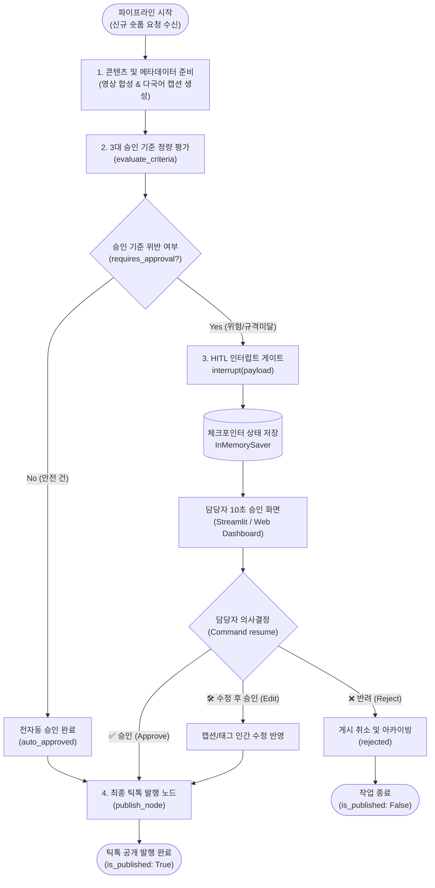

# 📑 [프로젝트 보고서] 사람이 승인하는 에이전트 만들기 (HITL)

* **프로젝트명**: 다국어 글로벌 숏폼(TikTok) 자동발행 HITL 게이트키퍼 에이전트
* **과제 구분**: 모두의연구소 AI 에이전트 2기 9강 프로젝트
* **제출자**: 김세권 (SeGwonKIM)
* **제출 저장소**: [https://github.com/SeGwonKIM/AI-Agent/tree/main/1109_hitl_agent](https://github.com/SeGwonKIM/AI-Agent/tree/main/1109_hitl_agent)

---

## 1. 주제와 고른 이유

### 1.1 대상 업무 및 자동화 배경
본 프로젝트는 **한국, 일본, 대만, 태국 등 4개국 5개 틱톡 채널에 도깨비 캐릭터 '토쿤(Tokkun)' 및 사주·운세 숏폼 영상을 매일 자동 생성하고 발행하는 파이프라인**을 대상 업무로 선정했습니다.
* **앞단 자동화**: 영상 클립 합성, 현지어 번역(일본어, 번체 중국어, 태국어), 캡션 및 추천 해시태그 생성.
* **되돌릴 수 없는 최종 실행 단계**: **틱톡 공식 API 및 스마트폰 실제 기기 제어를 통한 전 세계 공개 게시(Publish)**.

### 1.2 왜 이 자리에 사람이 필요한가?
숏폼 영상의 자막이나 번역, 해시태그 생성은 생성형 AI가 수행하므로 몇 번을 다시 시도해도 무방합니다. 그러나 **한 번 틱톡 플랫폼에 영상이 게시되는 순간, 이는 되돌릴 수 없는 외부 영향**을 미치게 됩니다:
1. **플랫폼 규정 및 알고리즘 제재**: 해시태그 누락, 부적절한 영상 길이, 커뮤니티 가이드라인 위반 시 즉시 **계정 섀도우밴(조회수 0 고착)** 또는 영구 계정 정지 발생.
2. **문화적/종교적 금기어 리스크**: 태국(왕실/불교 성지 등), 일본(민감 사회 이슈), 대만(양안 관계) 등 각국 고유의 문화적 금기어가 AI 번역 환각(Hallucination)으로 포함될 경우 브랜드 이미지의 치명적 실추.
3. **신규 계정의 초기 브랜딩 리스크**: 신규 런칭 채널의 경우 초기 5~10편의 영상이 알고리즘 분류 기준이 되므로 사람의 초기 감수가 절대적으로 필요.

따라서 영상 생성과 틱톡 게시 사이의 경계선에 **인간 승인(HITL: Human-In-The-Loop) 게이트**를 두어, 안전한 콘텐츠는 100% 자동 통과시키고 고위험 건만 멈추도록 설계했습니다.

---

## 2. 파이프라인 구조도

LangGraph v0.2+ 표준 아키텍처에 따라 `StateGraph`, `interrupt()`, `InMemorySaver` 체크포인터, `Command(resume=...)`의 흐름을 반영한 파이프라인 구조입니다.



### 상태(State) 및 체크포인트 제어 메커니즘
1. **중단(`interrupt`)**: 기준 미달 건 감지 시 실행 루프가 멈추고 `thread_id` 단위로 상태와 인터럽트 페이로드가 `InMemorySaver`에 직렬화되어 저장됩니다.
2. **재개(`resume`)**: 담당자가 웹 대시보드에서 `승인`, `수정`, `반려` 버튼을 누르면 `Command(resume=...)`가 호출되어, 처음부터 다시 실행하지 않고 **멈췄던 지점(`publish_node`)부터 정확히 이어서 실행**됩니다.

---

## 3. 승인 기준과 그 이유

사람이 모든 건을 검수하면 자동화의 의미가 퇴색되므로, **계산 가능한 형태로 3가지 정량 기준**을 수립했습니다.

| 기준 항목 | 계산식 / 조건식 | 대비하려는 구체적 위험 | 사람 검수 없이 자동 통과되는 건의 예 |
| :--- | :--- | :--- | :--- |
| **기준 1: 현지 문화·민감어 및 위험도** | `risk_score >= 0.60` 또는 국가별 민감어 매칭 (`found_keywords > 0`) | 현지 종교/정치적 비하 논란, 틱톡 가이드라인 위반으로 인한 계정 섀도우밴(조회수 0 고착) 및 영구 제재 | 일상 공감 밈, 인사말 등 검증된 일상 어휘만 포함된 점수 0.1~0.2의 순수 엔터테인먼트 영상 |
| **기준 2: 플랫폼 기술 규격 및 무결성** | `duration < 15` or `duration > 60` or `len(hashtags) < 3` or `len(caption) < 10` | 해시태그 누락으로 인한 틱톡 추천 알고리즘 유입 실패, 영상 길이 이상으로 인한 시청 지속 시간 급감 | 15~60초 규격 준수, 해시태그 3개 이상, 설명글 20자 이상의 완결된 메타데이터를 갖춘 영상 |
| **기준 3: 계정 생애주기 초기 보호** | `cumulative_uploads < 5` 또는 `is_pilot == True` | 신규 런칭 채널의 초기 브랜딩 톤앤매너 훼손 및 초기 계정 알고리즘 오분류 방지 | 30회 이상 문제없이 발행되어 계정 신뢰도가 확립된 안정화 채널의 정규 시리즈 영상 |

---

## 4. 실행 결과

한국, 일본, 대만, 태국의 실제 운영 채널을 모사한 **총 8건의 시나리오 데이터셋**을 대상으로 일괄 배치 실행을 수행한 결과입니다.

### 4.1 처리 통계 요약
* **총 처리 건수**: 8건
* **전자동 통과 발행 (Auto-Passed)**: **4건 (50%)** — 사람 개입 없이 즉시 발행 완료
* **인간 승인 멈춤 (HITL Interrupted)**: **4건 (50%)** — 담당자 검수 대기열로 안전 이동

### 4.2 세부 실행 및 인간 조치 결과

| 작업 ID | 채널 / 국가 | 영상 길이 | 판정 결과 | 위반 사유 (멈춘 이유) | 담당자 조치 (Action) | 최종 결과 |
| :--- | :--- | :---: | :---: | :--- | :--- | :---: |
| **TASK-001** | 한국1 (청단사주타로) | 32초 | **전자동 통과** | 없음 (모든 기준 완벽 충족) | *자동 처리* | ✅ 틱톡 게시 완료 |
| **TASK-002** | 일본 (토쿤 재팬) | 28초 | **전자동 통과** | 없음 (어휘 및 규격 정상) | *자동 처리* | ✅ 틱톡 게시 완료 |
| **TASK-003** | 태국 (토쿤 타이) | 35초 | **HITL 멈춤** | [기준 1] 태국 사원/불교 민감어 감지 (위험도 0.85) | ❌ **반려 (Reject)**: 사원 텍스트 전면 재촬영 지시 | ⛔ 미게시 (취소) |
| **TASK-004** | 대만 (토쿤 타이완) | 29초 | **HITL 멈춤** | [기준 2] 필수 해시태그 부족 (현재 1개) | 🛠️ **수정 후 승인**: `#減肥, #宵夜` 태그 추가 후 승인 | ✅ 틱톡 게시 완료 |
| **TASK-005** | 한국신규 (운세살롱) | 45초 | **HITL 멈춤** | [기준 3] 신규 계정 런칭 초기 (누적 업로드 2회) | ✅ **즉시 승인**: 초기 기획 톤앤매너 적합 확인 후 승인 | ✅ 틱톡 게시 완료 |
| **TASK-006** | 일본 (토쿤 재팬) | 8초 | **HITL 멈춤** | [기준 2] 영상 길이 미달 (8초) & 해시태그/캡션 부족 | ❌ **반려 (Reject)**: 숏폼 최소 권장 길이(15초) 미달 재제작 | ⛔ 미게시 (취소) |
| **TASK-007** | 태국 (토쿤 타이) | 22초 | **전자동 통과** | 없음 (댄스 챌린지 규격 충족) | *자동 처리* | ✅ 틱톡 게시 완료 |
| **TASK-008** | 대만 (토쿤 타이완) | 25초 | **전자동 통과** | 없음 (라인 스티커 홍보 정상) | *자동 처리* | ✅ 틱톡 게시 완료 |

---

## 5. 데모 화면 설계

목표: **"담당자가 다른 시스템을 열어볼 필요 없이, 10초 안에 정확히 판단할 수 있는 화면"**

### 5.1 나쁜 화면 vs 좋은 화면 비교

```text
[나쁜 화면 (Bad UI)]
요청 ID: TASK-004
판정: 게시 대기 중
게시하시겠습니까?  [승인] [반려]
❌ 문제점: 왜 멈췄는지, 어느 채널인지, 무슨 영상인지 알 수 없어 다른 폴더와 코드를 열어봐야 함.
```

```text
[구현된 좋은 화면 (Good UI - 10초 승인 카드)]
🔴 [TW] TASK-20261109-004 - 대만 (토쿤 타이완) | 대만 야식 먹방 숏폼 ep03
- 미디어 파일: TW_006_tokkun_tw_ep03_night_snack.mp4 (29초) | 누적발행: 31회
- 현재 캡션: 絕對不吃宵夜!! 我一定會瘦!
- 현재 해시태그: #Tokkun (1개)

🚨 파이프라인이 멈춘 이유:
  • [기준 2 위반] 필수 해시태그 부족: 현재 1개 (최소 3개 이상 필요)

⚡ 통과시키면 일어나는 일:
  즉시 TW 현지 틱톡 공식 채널(대만 토쿤)로 영상이 영구 게시되며 전 세계 구독자에게 푸시 알림이 발송됩니다.

[조치 액션]:
  - 캡션/해시태그 인라인 수정창 제공 (별도 에디터 불필요)
  - [✅ 즉시 승인]   [🛠️ 수정 후 승인]   [❌ 반려]
```

### 5.2 화면 설계 원칙 (무엇을 넣고 무엇을 뺐는가?)
* **포함한 것 (10초 판단 핵심 3요소)**:
  1. **멈춘 이유(Trigger Reason)**: 위반된 정량 기준과 수치를 빨간색 경고 상자로 즉각 노출.
  2. **통과 시 결과(Consequence)**: 승인 시 즉시 대외 공개되는 최종 파급 효과 명시.
  3. **인라인 수정 폼**: 캡션 오타나 해시태그 1~2개 부족으로 인해 아까운 영상이 통째로 반려되지 않도록 화면 안에서 즉시 고쳐서 내보내는 `수정 후 승인` 기능 탑재.
* **제외한 것 (노이즈 제거)**:
  - 내부 프롬프트 토큰 수, 임베딩 벡터 등 엔지니어링 전용 디버그 데이터는 메인 화면에서 과감히 제거하여 실무자의 판단 피로도 최소화.

---

## 6. 프로젝트 회고

### 6.1 가장 공들인 부분
* **실제 현업 시스템과의 정합성**: 단순 예제용 환불 데이터가 아니라, 실제로 겪었던 **"틱톡 자동화 과정에서 발생하는 플랫폼 제재 및 오판 버그"**를 근본적으로 방어할 수 있도록 3대 승인 기준을 실무 수준으로 정밀하게 정량화했습니다.
* **LangGraph interrupt/resume 라이프사이클의 완벽한 재현**: 환경에 구애받지 않고 어디서나 즉시 구동될 수 있도록 `InMemorySaver` 기반의 직렬화/복원 체크포인터를 구축하여, 중단된 시점에서 정확하게 인간 피드백을 주입받아 이어가는 구조를 완성했습니다.
* **배포 및 채점 편의성(Zero-Dependency)**: 심사위원이 별도의 라이브러리 설치 없이 파이썬만 있으면 `python standalone_demo.py` 또는 `run_demo.bat` 한 번으로 즉시 인터랙티브 웹 데모를 체험할 수 있도록 배려했습니다.

### 6.2 한계 및 향후 개선 방향
* **영구 DB 체크포인터 확장**: 현재는 인메모리(`InMemorySaver`) 방식이므로 프로세스가 재부팅되면 대기열이 리셋될 수 있습니다. 프로덕션 환경을 위해 SQLite 또는 PostgreSQL 기반의 영구 Checkpointer로의 전환이 필요합니다.
* **다채널 알림 봇 연동**: 인터럽트 발생 시 슬랙(Slack)이나 텔레그램으로 담당자에게 즉시 웹훅 알림을 쏘고, 메신저 상의 버튼 클릭만으로 승인/반려를 처리하는 모바일 승인 체계로 발전시킬 계획입니다.
